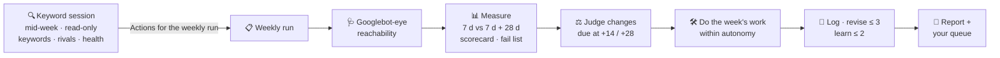

<div align="center">

# 🌱 seo-living-plan

**An SEO plan that measures itself, judges its own changes, and gets smarter every week.**

A [Claude skill](https://docs.claude.com/en/docs/agents-and-tools/agent-skills/overview) built from three months of running real client sites. It's not a prompt someone thought up.


</div>

---

## SEO plans die in week three

You write a great quarterly plan. Then:

- 📉 **One noisy week fools you.** A keyword jumps 15 places, you celebrate, and next week it's back.
- 🤷 **Nobody re-measures anything.** You changed a title a month ago. Did it work? No one wrote down the baseline.
- 🔁 **Every site relearns the same trap.** The bug you fixed on client A breaks client B three weeks later.
- 📭 **Finished work never ships.** The listing claim is drafted, the page is written, and both sit "waiting for the doctor" for a month.
- 🧊 **The plan freezes.** The data has moved, and the plan written in month one hasn't.

**seo-living-plan** makes Claude run SEO the disciplined way, every week, without being reminded.

## What a weekly run looks like

An excerpt from a [real test run](examples/weekly-report-dental-practice.md) (made-up dental practice, synthetic Search Console data):

```text
# Ava Dental — week 4 · ۲۴ آبان ۱۴۰۵ (2026-11-15)
blocked: site reachability check — no network access from this workspace. Last known
result (11-12): DNS ok · Googlebot 200. This is NOT a pass for this week.

Alerts:
- DROP — «دندانپزشکی پونک» left the top 3: 2.8 → 4.1 on 140 impressions.
- 404: /blog/کامپوزیت-یا-لمینت/ since 11-10 (had 64 impressions). Fix packaged.

Fail list (not in the top 3, ≥ 20 impressions / 28 d):
1. «قیمت لمینت دندان» · 24.5 — skipped: a price range is a fact; unblocks when the doctor
   gives it in writing.
2. «دندانپزشکی پونک» · 4.1 — drop alert. Homepage title package this week.
4. «لمینت دندان پونک» · 11.2 — skipped: +28 recheck due 11-18, page stays unchanged.

Verdicts:
- Implant title + H1 (10-12), +28 → worked: 9.8 → 7.1, CTR 1.4 → 3.8 %, 236 impr.

Not done as written:
- "Copy the address from Neshan into the schema" → refused. The plan records that
  Neshan has the OLD address. Facts come only from the owner.

Your queue (65 of 180 min):
1. [week 3 carried] Send the doctor ONE message with 3 yes/no questions (5 min).
```

That one run used every rule below.

## The ten rules

| | Rule | Why it exists |
|---|---|---|
| 1 | **Check the site the way Googlebot sees it, first** | A security plugin served HTTP 500 *only to Googlebot*, while browsers and Google's own live test got 200 |
| 2 | **Measure complete days, per query** | Search Console lags ~2 days, and a site's average position gets *worse* when it starts ranking for new queries |
| 3 | **Every change gets a baseline and rechecks at +14 / +28 days** | Without them, "did it work?" has no answer |
| 4 | **Revise the plan from evidence only, at most 3 changes a week** | Plans that change on a hunch never settle |
| 5 | **Facts come only from the owner** | Prices, hours and medical claims copied from a rival or a stale listing are how trust breaks |
| 6 | **Bundle stuck asks into one message of ≤ 3 yes/no questions** | 0 of 13 drafted listings had been sent; direct short asks came back in a day |
| 7 | **Never end a run without a file** | Scheduled runs reported "succeeded" after writing nothing |
| 8 | **Learn across sites** | A shared `lessons.md` turns one site's surprise into every site's checklist |
| 9 | **Say what's measured and what's inferred** | Google decides positions. Never promise #1 |
| 10 | **White-hat only, and pace the robots** | Google blocks rival searches after ~7 quick queries; never get around a CAPTCHA |

## Stories from the field

Every lesson in [`field-lessons.md`](skills/seo-living-plan/references/field-lessons.md) (29 of them) comes from a real site. Client names are left out. A few highlights:

<details>
<summary><b>The domain that vanished on a Thursday</b></summary>

The registrar put a medical site on <i>client hold</i> a day after its renewal date. DNS answered NXDOMAIN, but the server kept serving the site by IP, so it "worked" for anyone who had it cached. Google kept showing it for about 2.5 days, then impressions fell **99 %**. Now every run checks DNS and registration status first.
</details>

<details>
<summary><b>The firewall that only hated Google</b></summary>

After a hosting move, an outdated security plugin crashed on its "is this really Google?" check. Googlebot got HTTP 500 on every page, robots.txt included. Browsers, Bingbot *and* URL Inspection's live test all got 200, so every normal check passed. A `curl` with a Googlebot user agent caught it. Most of the traffic came back within a day of the fix.
</details>

<details>
<summary><b>The doctor who lost her own name</b></summary>

Two booking platforms hosted profiles of a dentist that nobody at the practice knew about. One listed the wrong specialty and promoted three competing surgeons. The other, with no link to her site, climbed to **#1 for her full name** while the claim request sat drafted and unsent. The lesson: claim before you create, and a drafted claim does nothing until it's sent.
</details>

<details>
<summary><b>The canonical tag hiding in the body</b></summary>

Next.js 15.2+ streams `<title>` and `rel=canonical` into `<body>` for Googlebot on dynamic routes, and Google ignores a canonical outside `<head>`. URL Inspection's live test can't see the problem, because it's on Next's "limited bots" list and Googlebot isn't. One config line (`htmlLimitedBots`) fixed it.
</details>

<details>
<summary><b>The 15-place jump that wasn't</b></summary>

A low-volume keyword went 25 → 10.4 in a week with no change to the page, then back to 19.5 the next week. On another site, a page went 76 → 45 → 72. Hence rule 2: on small sites, credit nothing to one week, and judge on 28 days.
</details>

## How it works



Each site has **one plan file** (decisions, ranking strategy, a 13-week table, then a Weekly log, a Change log, Plan revisions and Proposals), a **keyword tracker** and a **rivals file**. **One `lessons.md`** is shared across all your sites.

## Does it actually help?

Three realistic tasks, each run once **with** and once **without** the skill on the same model (Claude Opus 5.5), and graded against 24 written checks:

| Task | With skill | Without |
|---|:---:|:---:|
| Set up a quarter plan for a bakery from 8 weeks of exports | **10 / 10** | 6 / 10 |
| Run week 4 of a Persian dental practice's plan | **10 / 10** | 6 / 10 |
| "Did my title change work, and can I edit the H2s now?" | **4 / 4** | 2 / 4 |
| **Total** | **24 / 24** | **14 / 24** |

Without the skill, Claude still writes a sensible plan. What it skips is the discipline:
- no baseline or recheck dates for the next change;
- more plan revisions than the evidence supports;
- a keyword leaving the top 3 labelled "watch" instead of an alert;
- weekly human time over budget;
- informational queries counted as sales;
- messages to the owner with blanks still to fill.

The skill costs about 30 % more tokens per run. These are single runs on synthetic data, so treat the numbers as indicative. You can rerun them yourself (see below).

## Install

```bash
npx skills add Amirjaz/seo-living-plan
```

Or copy [`skills/seo-living-plan/`](skills/seo-living-plan/) into `~/.claude/skills/` (all projects) or `.claude/skills/` (one project).

## Use

Just ask. The skill starts on its own, or you can type `/seo-living-plan`.

```text
Set up a living SEO plan for this site for next quarter. Exports are in /data. I have 2 hours a week.
Run this week's SEO plan.
I changed the title on /pricing on Oct 14 — before 8.4 / 1.2 %, now 7.9 / 1.9 %. Did it work?
Do the mid-week keyword check for the clinic site.
```

It works on demand, and works best as **two scheduled jobs per site**: a keyword session mid-week and a weekly run a few days later.

## What's inside

```
skills/seo-living-plan/
├── SKILL.md                    the method: modes + the 10 rules (~100 lines)
├── references/
│   ├── plan-template.md        setting up a plan + the plan skeleton
│   ├── weekly-run.md           the 11-step weekly run
│   ├── keyword-session.md      keyword, rival (paced) and health checks
│   ├── measurement.md          windows, scorecard, fail list, verdict thresholds
│   ├── ranking-playbook.md     levers A–H, from push zone to ecommerce
│   ├── site-checks.md          Googlebot-eye reachability + stack-specific traps
│   ├── field-lessons.md        29 lessons from seven live sites
│   └── regional-notes.md       Iran: no Google Business Profile, Neshan/Balad, «مطب» vs «کلینیک»
├── assets/                     lessons · keyword-tracker · rivals templates
├── scripts/gsc_compare.py      the arithmetic, done the same way every time
└── evals/                      3 test cases (claude plugin eval format)
examples/                       unedited outputs from the test runs
```

### The helper script

[`gsc_compare.py`](skills/seo-living-plan/scripts/gsc_compare.py) uses only the Python standard library, so there's nothing to install. It runs the same on Windows, macOS and Linux and reads GSC CSV exports or JSON rows from the API.

```bash
python scripts/gsc_compare.py window  --daily daily.csv
#  → latest complete day (skips a half-filled last day), 7- and 28-day windows, totals

python scripts/gsc_compare.py compare --cur q-cur.csv --prev q-prev.csv \
    --brand "acme,اکمی" --tracked keyword-tracker.md --q28 q-28d.csv
#  → brand split, scorecard, DROP ALERTS, fail list, push zone, new top-3/10

python scripts/gsc_compare.py verdict --base-pos 8.4 --base-ctr 1.2 --new-pos 7.9 --new-ctr 1.9 --impressions 702
#  → worked — CTR +58 % at a similar position (8.4 → 7.9)
```

It handles Persian keyword spellings too: «بابا حاجی» and «باباحاجی», ي and ی, ك and ک, and half-spaces all match the same tracked keyword.

## FAQ

**Does it need the Search Console API?** No. It works with CSV exports, a connector, or the Search Console page itself. A connector is just faster.

**Will it change my site on its own?** Only within the autonomy level you write into the plan, for example "drafts only" or "titles, links and schema". Facts and medical or legal claims always go to you.

**Is it only for Iranian sites?** No. It was built on Persian and English sites, so Persian works properly (Jalali dates, RTL keywords, local platforms), but the method has nothing Iran-specific in it. The bakery example is in Austin.

**Can I rerun the tests?** Yes: `claude plugin eval skills/seo-living-plan --allow-tools Write,Edit,Bash --scaffold`. These are real, billed model runs.

## Safety

The skill bundles no network calls and asks for no tool pre-approvals, and the script only reads local files. Live checks (`curl` to your domain, Google searches for rival checks) go through your normal permission prompts. Rival searches are paced, and the skill stops at the first CAPTCHA.

---

<div align="center">

Built by **[Amir Jazayeri](https://github.com/Amirjaz)**, web developer and SEO for clinics, local businesses and shops.
If it saves you a Monday, a ⭐ helps others find it.

MIT License

</div>
